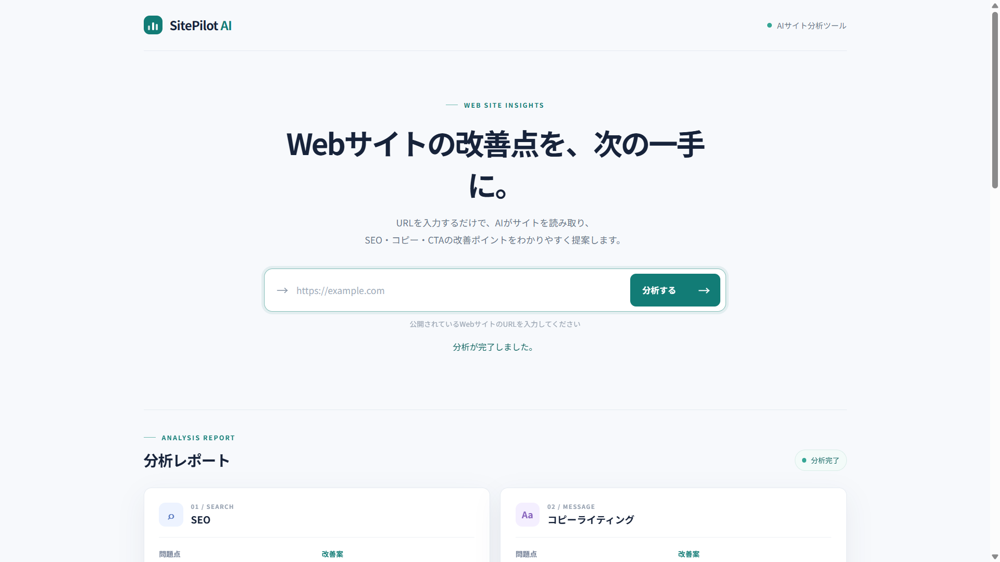

# SitePilot AI

URLを入力するとWebページを取得・解析し、AIがSEO、コピーライティング、CTA、読みやすさなどの観点から改善案を提案するWebアプリです。

このリポジトリはAIエンジニア長期インターン応募用のポートフォリオです。GitHubでソースコードを公開し、ローカル環境で動かしてデモすることを想定しています。本番サーバーへの公開はしていません。

## デモ画面

スクリーンショットを追加する場合は、画像を `images/demo.png` に置いてください。



## 開発背景・目的

Pythonの基礎から学びながら、Webスクレイピング、LLM API、Structured Outputs、FastAPIによるWeb API、HTML・CSS・JavaScriptを使った画面づくりを一つのアプリにまとめました。入力からAIの分析結果表示までの流れを実装し、各技術がどう連携するかを学ぶことを目的にしています。

## 主な機能

- URLを受け取り、WebページのHTMLを取得
- title、meta description、h1、h2、body本文を抽出して `page_data` に整理
- OpenAI APIでSEO、コピーライティング、CTA、読みやすさなどを分析
- Pydanticモデルを使ったStructured Outputsで、分析結果を一定のJSON構造で受け取る
- FastAPIの `POST /analyze` から分析結果を返す
- ブラウザから分析を実行し、結果をカード形式で表示
- 入力・取得・AI分析のエラーをHTTPステータスに変換

## システム構成と処理フロー

```text
ブラウザ（HTML / CSS / JavaScript）
  → FastAPI（POST /analyze）
  → requestsで対象Webページを取得
  → BeautifulSoupでページ情報を抽出
  → OpenAI APIへpage_dataを送信
  → Pydantic + Structured Outputsで形式を指定
  → JSONレスポンス
  → JavaScriptで分析カードに表示
```

APIの受付・HTTPエラー変換は `api.py`、ページ取得とAI分析は `analyzer.py` に分けています。画面のHTML、スタイル、ブラウザー側の処理は `static/` に置いています。

## 使用技術

| 技術 | 採用理由 |
| --- | --- |
| Python | ページ取得やAI API連携をまとめて実装するため |
| FastAPI | URLを受け取るWeb APIを作るため |
| requests / BeautifulSoup | HTMLを取得し、必要な要素を抽出するため |
| OpenAI API | ページ情報を自然言語で分析するため |
| Pydantic / Structured Outputs | AIの返却データを画面で扱いやすい構造にするため |
| HTML / CSS / Vanilla JavaScript | 外部フレームワークを追加せず、入力と結果表示を実装するため |
| python-dotenv | 開発時のAPIキーを `.env` から読み込むため |
| Git / GitHub | 変更履歴を管理し、ソースコードを共有するため |

## ディレクトリ構成

```text
sitepilot-ai/
├── api.py                 # FastAPIの画面配信とAPIエンドポイント
├── analyzer.py            # ページ取得・解析とOpenAI API呼び出し
├── main.py                # CLIから分析を実行する入口
├── requirements.txt       # Python依存パッケージ
├── README.md
├── .gitignore
├── .env                   # APIキー（Git管理外・各自で作成）
└── static/
    ├── index.html         # 画面の構造
    ├── style.css          # 画面のスタイル
    └── app.js             # API呼び出しと分析結果の表示
```

## セットアップ

Python 3.11以降を用意してください。プロジェクトのルートで仮想環境を作成して有効化し、依存パッケージをインストールします。

**Windows PowerShell**

```powershell
py -m venv .venv
.\.venv\Scripts\Activate.ps1
python -m pip install -r requirements.txt
```

**macOS / Linux**

```bash
python3 -m venv .venv
source .venv/bin/activate
python -m pip install -r requirements.txt
```

プロジェクトのルートに `.env` ファイルを作り、自分のOpenAI APIキーを設定してください。

```dotenv
OPENAI_API_KEY=your_api_key_here
```

この値は説明用の例です。利用者自身のキーに置き換えてください。`.env` は `.gitignore` に含まれており、GitHubへコミットしないでください。

## 起動方法

仮想環境を有効にした状態で、プロジェクトのルートから起動します。

```bash
python -m uvicorn api:app --reload
```

ブラウザーで `http://127.0.0.1:8000` を開き、分析したいWebサイトのURLを入力します。アプリはローカルで実行します。

## API仕様

### `POST /analyze`

Webページを分析し、Structured Outputsで定義したJSONを返します。

リクエスト:

```json
{
  "url": "https://example.com"
}
```

成功時のレスポンスには、`seo`、`copywriting`、`cta`、`readability`（それぞれ `issues` と `suggestions`）、`target_audience`、`overall_issues`、`title_suggestion`、`meta_description_suggestion`、`h1_suggestion` が含まれます。

## エラー処理

| 状況 | HTTPステータス | 処理 |
| --- | --- | --- |
| URLが空、またはURL形式が不正 | 422 | Pydanticの `HttpUrl` で入力を検証 |
| 対象サイトへの接続がタイムアウト | 504 | requestsの10秒タイムアウトを捕捉 |
| 対象サイトの取得失敗・HTTPエラー | 502 | リクエスト例外を捕捉 |
| OpenAI API失敗、または分析結果を取得できない | 503 | AI分析の失敗を捕捉 |

## 工夫した点

- APIの受付と分析処理を別ファイルに分け、役割を追いやすくした
- `HttpUrl` で入力を入口で検証し、requestsには検証済みURLを渡す
- PydanticモデルとStructured Outputsを使い、分析結果を一定の形で受け取る
- APIキーは `.env` から読み込み、`.env`・`.venv`・`__pycache__` はGit管理から除外
- 外部サイトのタイムアウトや取得失敗、OpenAI APIの失敗をHTTPステータスに変換
- JSONをそのまま表示せず、観点ごとのカードと改善テキスト案に分けて表示

## 学んだこと

HTTPのGETとPOST、JSONによるデータの受け渡し、FastAPIのエンドポイント、Pydanticによる入力検証とデータ構造の定義を学びました。また、Webページ取得からLLM API呼び出し、エラー処理、Gitでの変更管理までをつなげて実装しました。

## 今後の改善

以下は今後の改善案で、現在は実装していません。

- 複数ページの解析
- JavaScriptで描画されるページへの対応
- SQLiteを使った分析履歴
- テストコードとレート制限
- 本文抽出精度の改善
- AI分析処理の役割分割
- ローカル実演を前提とした動作確認・セットアップ手順の改善

## GitHub公開前の確認

- `.env` やAPIキーがコミット対象に含まれていないことを確認する
- `.gitignore` が `.env`、`.venv/`、`__pycache__/` を除外していることを確認する
- READMEのセットアップ手順を新しい仮想環境で実行できることを確認する
- `images/demo.png` を追加した場合、公開して問題のない画面・URLだけが写っていることを確認する
